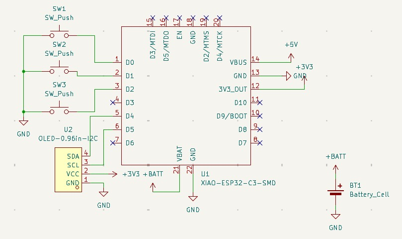
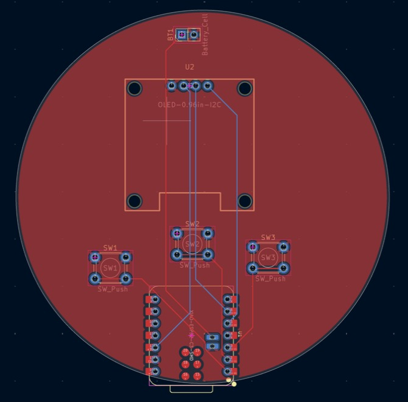
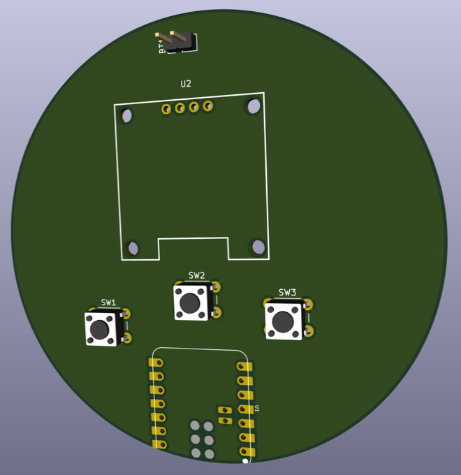

# Sapling Journal

## Entry 1: A generic Tamagotchi PCB and the plan for a solar plant pet
**Date:** November 20, 2026
**Time spent:** _ hours

For my first step, I designed a sample PCB and schematic in KiCad 10 that works as a generic base for any Tamagotchi-style pet. It's a round, two-layer board about 79 mm across, built around a Seeed XIAO ESP32-C3 as the brain. A 0.96" I2C OLED (U2) is the screen, with SDA on D4, SCL on D5, and power from the XIAO's 3.3 V output. Three push buttons (SW1–SW3) sit on D0–D2 and switch to ground. That means I can use the ESP32's internal pull-ups and skip extra resistors. A 2-pin header (BT1) connects a battery to the XIAO's VBAT pad, so the board can run off a LiPo and charge it over the XIAO's USB-C port. The finished layout has 6 footprints, 26 track segments and a ground pour, and it's fully routed with 0 unrouted nets. I kept it generic on purpose: the board doesn't care what the pet is, so I can test firmware for any creature on it before I commit to a final design.

*Schematic: XIAO ESP32-C3, OLED on I2C, three buttons, battery header.*

*PCB layout in KiCad's PCB Editor.*

*3D view of the finished board.*

Now that the base board is done, I've decided what the pet will be: a tree. The idea is called Sapling, a little potted tree whose pixel "sapling spirit" grows from a seed into a sprout, a sapling, a young tree, and finally an old tree, depending on how well you take care of it. The three buttons become the care actions: water it, shoo away pests, and add compost. The twist is that real sunlight counts as food. A light sensor feeds the in-game sun meter, so the tree is happiest when you actually leave it somewhere bright. It will also use the real date to change with the seasons, with blossoms in spring, orange leaves in fall, and bare branches in winter. The case will be a potted tree designed in Fusion 360: the electronics and some steel washers for weight sit in a terracotta-style pot so it stands on its own, a hollow trunk carries the wires, and a solar cell sits in the leafy canopy.

That solar goal changes the next version of the board. The 0.96" OLED is great for testing, but it pulls power the whole time it's on. For v2 I'm planning to switch to a Sharp Memory LCD, which can stay on almost for free. I'll also add a BQ25570 energy-harvesting chip with an indoor amorphous solar cell, a low-power RTC to keep time and seasons, and a small light sensor. The board will also need to shrink: at 79 mm it's wider than the ~60 mm pot I'm planning, so the buttons will move up to the pot's rim as "pebbles." My next steps are to get a button-and-display test running on this generic board, start the pot and canopy in Fusion 360, and begin the v2 schematic with the solar power path.
