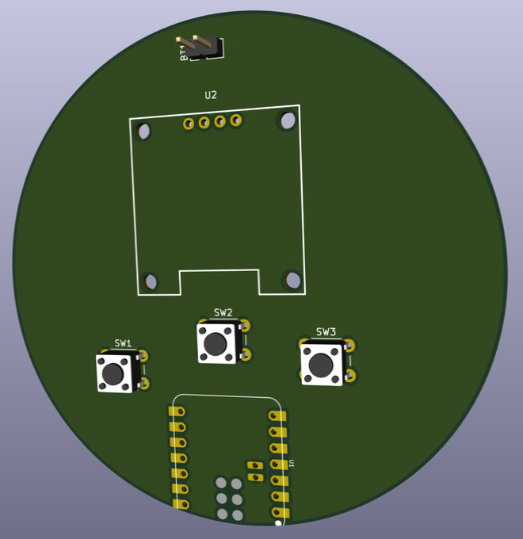
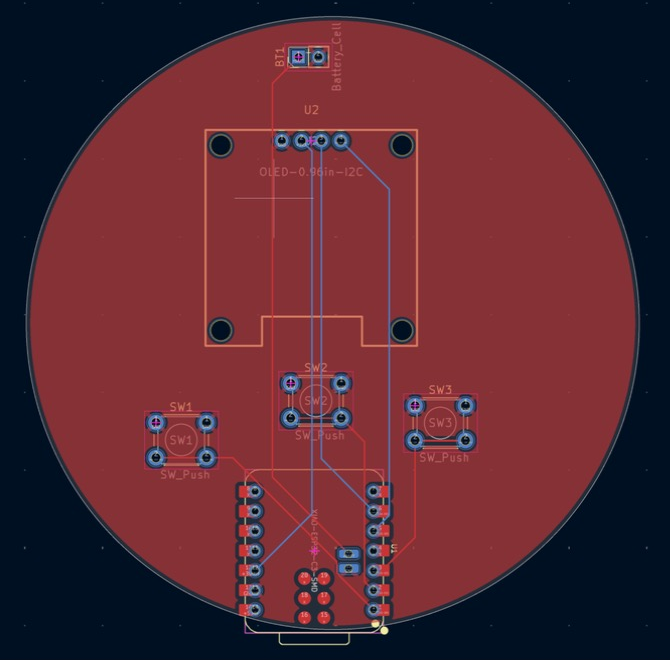
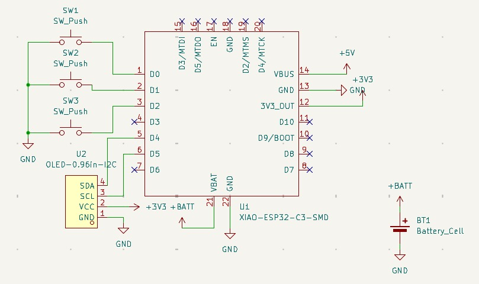

# Sapling: A Solar-Powered Tamagotchi Tree Pet

Sapling is a Tamagotchi-style virtual pet that's a little potted tree. Its pixel "sapling spirit" grows from a **seed → sprout → sapling → young tree → old tree** depending on how well you take care of it. The long-term goal is a self-standing potted-tree case with a solar cell in the canopy, so the pet literally lives on sunlight.

> **Status:** v1 board (generic Tamagotchi PCB) designed and routed. The case and the solar v2 board are in progress.

## What it contains
- A round, 2-layer PCB (~79 mm) built around a XIAO ESP32-C3
- A 0.96" SSD1306 OLED that shows the tree and its stats
- Three buttons for care actions
- A LiPo battery header, charged through the XIAO's USB-C port
- Firmware that runs the tree simulation, then deep-sleeps between updates to save battery

## How to use it
| Button | Action |
|---|---|
| SW1 (left) | Water the tree |
| SW2 (middle) | Shoo away a pest |
| SW3 (right) | Add compost |

Press any button to wake it up. The screen shows the tree's stage and its water, soil, and mood bars. Every 5 minutes it wakes on its own to get a little thirstier, and sometimes a pest shows up. Keep its mood above 50% and it grows a stage after 1, 5, 14, and 30 days. After 20 seconds without a press, it goes back to sleep.

## Why I made it
I wanted to make an unconventional Tamagotchi based on the environment, that also has more uses than simply engagement. With versatility, it's equipped to withstand the test of boredom by also doubling as a perpetual desk mate. This project also serves as a practical way to explore low-power design, as running the pet on a miniature solar cell requires optimizing down to the microamp/

## Screenshots

### Full 3D assembly

### PCB

### Schematic

### 3D render

## Repository contents
| Path | What's inside |
|---|---|
| `pcb/sapling/` | KiCad source (`.kicad_pro`, `.kicad_sch`, `.kicad_pcb`, `.kicad_prl`), `gerbers.zip` (Gerbers + drill files), `sapling.step` (board 3D model) |
| `cad/` | Case STEP files + Fusion 360 `.f3d` assembly (coming soon) |
| `cad/printables/` | STL files for 3D printing (coming soon) |
| `firmware/sapling/` | Arduino firmware for the XIAO ESP32-C3 (untested) |
| `images/` | Screenshots used in this README |
| `BOM.csv` | Bill of materials with links |

## Roadmap
- [x] Generic Tamagotchi PCB + schematic (v1)
- [ ] Button + display test on the v1 board
- [ ] Potted-tree case in Fusion 360 (pot, trunk, canopy)
- [ ] v2 board: Sharp Memory LCD, BQ25570 solar harvester, RTC, light sensor, shrunk to fit a ~60 mm pot
- [ ] Seasons and real-sunlight "food" in firmware

## Credits
- XIAO ESP32-C3 by [Seeed Studio](https://www.seeedstudio.com/Seeed-XIAO-ESP32C3-p-5431.html)
- Display driver: [Adafruit SSD1306](https://github.com/adafruit/Adafruit_SSD1306) and [Adafruit GFX](https://github.com/adafruit/Adafruit-GFX-Library)

Made by Claire Yuan
